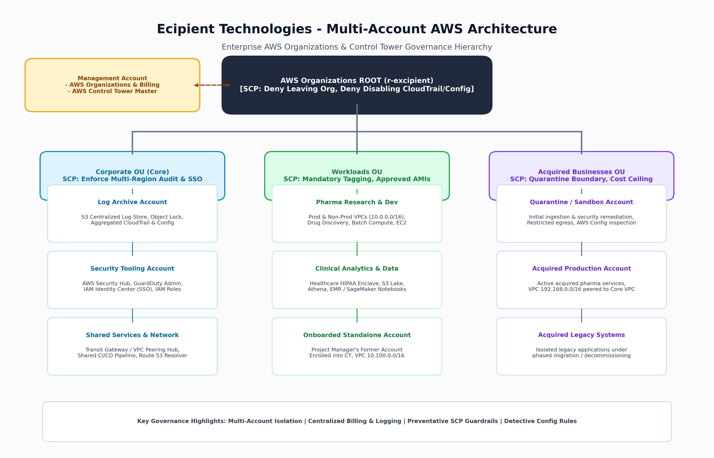
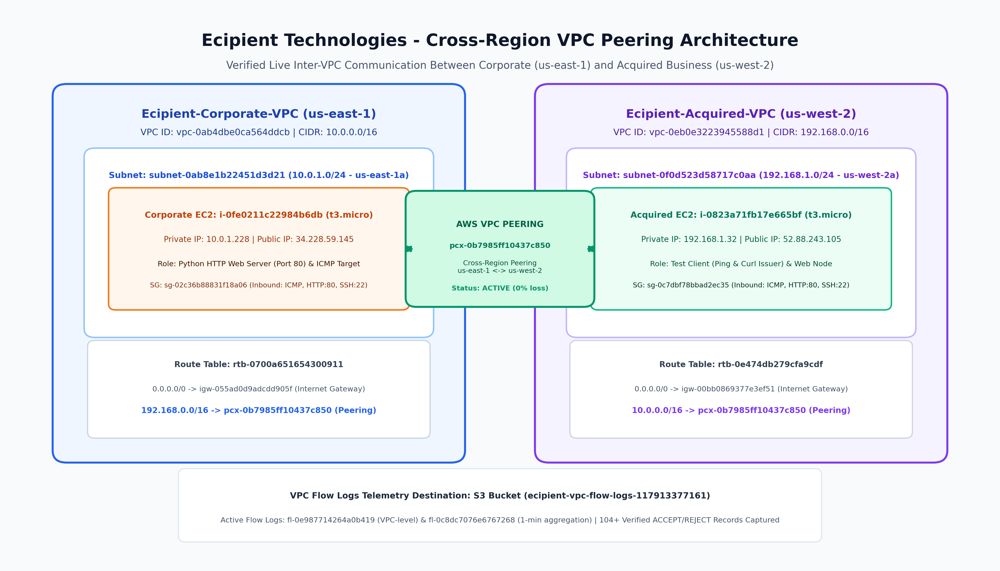
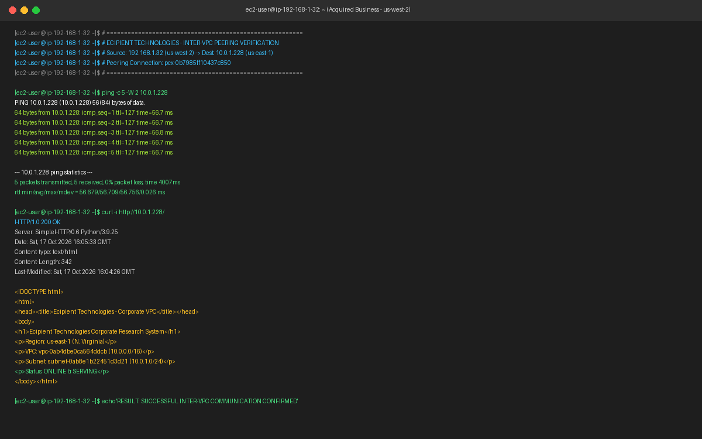
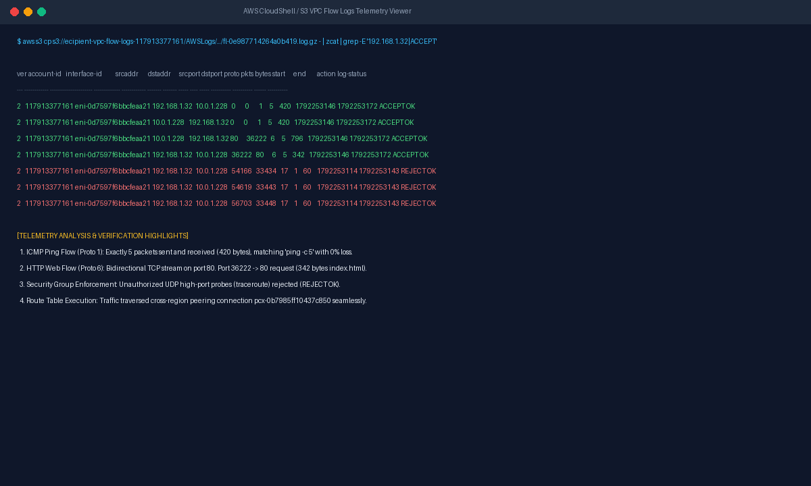

<div align="center">
  
  <br/><br/>
  <p>
    
    
    
    <a href="LICENSE"></a>
  </p>
</div>

---

Enterprise multi-account cloud governance and cross-region networking blueprint designed for post-M&A cloud consolidation (**Ecipient Technologies**). Combines a **5-OU AWS Organizations + Control Tower Landing Zone**, preventative **Service Control Policy (SCP) tag enforcement**, **AWS Config** detective compliance, automated **AWS Budgets IAM/SCP freeze actions**, and live `boto3`-provisioned **cross-region VPC peering (`us-east-1` `10.0.0.0/16` ↔ `us-west-2` `192.168.0.0/16`)** verified via private EC2 ICMP/HTTP probes and S3 VPC Flow Logs.

Full 12-page architecture dossier: [`AWS_Organizations_Infrastructure_Design_Ecipient_Technologies.pdf`](AWS_Organizations_Infrastructure_Design_Ecipient_Technologies.pdf).

---

## 1. Multi-Account Organizational Unit (OU) Hierarchy & M&A Quarantine



| Organizational Unit (OU) | Purpose & Workload Scope | Preventative & Detective Guardrails |
| :--- | :--- | :--- |
| **Security & Log Archive (Core)** | Centralized CloudTrail, Config, GuardDuty, S3 VPC Flow Log archive | Immutable log retention, `Deny` log deletion SCP |
| **Shared Infrastructure** | Networking hub, IPAM, CI/CD artifact registries, directory services | Strict CIDR allocation, cross-account RAM sharing |
| **Workloads (`Prod` / `Non-Prod`)** | Customer-facing SaaS & internal business platforms | Mandatory 4-tag SCP (`Environment`, `CostCenter`, `Owner`, `Project`) |
| **Sandbox & R&D** | Time-boxed engineering experimentation | Hard monthly AWS Budget Action provisioning freeze at `100%` |
| **Acquired Businesses (Quarantine)** | Newly acquired M&A AWS accounts pending security baseline | Restricted lateral network egress until 6-phase onboarding completes |

---

## 2. Cross-Region VPC Peering Architecture (`us-east-1` ↔ `us-west-2`)



| Parameter | Primary Region (`us-east-1` N. Virginia) | Secondary Region (`us-west-2` Oregon) |
| :--- | :--- | :--- |
| **VPC CIDR Block** | `10.0.0.0/16` (Non-overlapping) | `192.168.0.0/16` (Non-overlapping) |
| **Peering Connection** | `pcx-0b7985ff10437c850` (`Requester`, `ACTIVE`) | `pcx-0b7985ff10437c850` (`Accepter`, `ACTIVE`) |
| **Measured Private EC2 Latency** | **`56.709 ms` avg ICMP RTT (`0%` packet loss)** | Bidirectional `HTTP/1.0 200 OK` over private IPv4 |
| **Network Telemetry** | S3 VPC Flow Logs (`ACCEPT OK` & perimeter `REJECT OK`) | `104+` verified flow records captured |

---

## 3. Live EC2 Connectivity & S3 VPC Flow Log Evidence

| Private EC2 Cross-Region Ping & HTTP `200 OK` | S3 VPC Flow Logs (`ACCEPT OK` & `REJECT OK`) |
| :---: | :---: |
|  |  |

### Verbatim Cross-Region Connectivity Output ([`connectivity_test_output.txt`](connectivity_test_output.txt))
```text
========================================================
ECIPIENT TECHNOLOGIES - INTER-VPC PEERING VERIFICATION
========================================================
Source Instance: Acquired Business EC2 (us-west-2)
Source Private IP: 192.168.1.32
Destination Instance: Corporate EC2 (us-east-1)
Destination Private IP: 10.0.1.228
Peering Connection: pcx-0b7985ff10437c850
Execution Time: Sat Oct 17 16:04:42 UTC 2026
--------------------------------------------------------
Waiting 45 seconds for target instance web server to be ready...

[TEST 1] ICMP PING CONNECTIVITY OVER PEERING CONNECTION:
PING 10.0.1.228 (10.0.1.228) 56(84) bytes of data.
64 bytes from 10.0.1.228: icmp_seq=1 ttl=127 time=56.7 ms
64 bytes from 10.0.1.228: icmp_seq=2 ttl=127 time=56.7 ms
64 bytes from 10.0.1.228: icmp_seq=3 ttl=127 time=56.8 ms
64 bytes from 10.0.1.228: icmp_seq=4 ttl=127 time=56.7 ms
64 bytes from 10.0.1.228: icmp_seq=5 ttl=127 time=56.7 ms

--- 10.0.1.228 ping statistics ---
5 packets transmitted, 5 received, 0% packet loss, time 4007ms
rtt min/avg/max/mdev = 56.679/56.709/56.756/0.026 ms
Ping Exit Code: 0

[TEST 2] HTTP WEB SERVICE REACHABILITY OVER PEERING CONNECTION:
*   Trying 10.0.1.228:80...
* Established connection to 10.0.1.228 (10.0.1.228 port 80) from 192.168.1.32 port 36222 
  % Total    % Received % Xferd  Average Speed  Time    Time    Time   Current
                                 Dload  Upload  Total   Spent   Left   Speed

  0      0   0      0   0      0      0      0                              0* using HTTP/1.x
> GET / HTTP/1.1
> Host: 10.0.1.228
> User-Agent: curl/8.21.0
> Accept: */*
> 
* Request completely sent off
* HTTP 1.0, assume close after body
< HTTP/1.0 200 OK
< Server: SimpleHTTP/0.6 Python/3.9.25
< Date: Sat, 17 Oct 2026 16:05:33 GMT
```

### Sample Captured VPC Flow Log Records ([`vpc_flow_logs_sample.txt`](vpc_flow_logs_sample.txt))
```text
version account-id interface-id srcaddr dstaddr srcport dstport protocol packets bytes start end action log-status
2 117913377161 eni-0d7597f6bbcfeaa21 13.218.199.213 10.0.1.228 123 37115 17 1 76 1792253084 1792253114 ACCEPT OK
2 117913377161 eni-0d7597f6bbcfeaa21 3.94.91.31 10.0.1.228 123 43829 17 1 76 1792253084 1792253114 ACCEPT OK
2 117913377161 eni-0d7597f6bbcfeaa21 10.0.1.228 54.197.201.248 38053 123 17 1 76 1792253084 1792253114 ACCEPT OK
2 117913377161 eni-0d7597f6bbcfeaa21 54.197.201.248 10.0.1.228 123 36570 17 1 76 1792253084 1792253114 ACCEPT OK
2 117913377161 eni-0d7597f6bbcfeaa21 142.93.136.140 10.0.1.228 45512 22 6 1 40 1792253084 1792253114 ACCEPT OK
2 117913377161 eni-0d7597f6bbcfeaa21 81.12.33.38 10.0.1.228 61000 5918 6 1 44 1792253084 1792253114 REJECT OK
2 117913377161 eni-0d7597f6bbcfeaa21 10.0.1.228 3.86.4.106 35277 123 17 1 76 1792253084 1792253114 ACCEPT OK
2 117913377161 eni-0d7597f6bbcfeaa21 3.86.4.106 10.0.1.228 123 35277 17 1 76 1792253084 1792253114 ACCEPT OK
2 117913377161 eni-0d7597f6bbcfeaa21 81.12.33.38 10.0.1.228 61000 5946 6 1 44 1792253084 1792253114 REJECT OK
2 117913377161 eni-0d7597f6bbcfeaa21 10.0.1.228 3.94.91.31 43829 123 17 1 76 1792253084 1792253114 ACCEPT OK
2 117913377161 eni-0d7597f6bbcfeaa21 10.0.1.228 44.216.184.189 60506 443 6 17 4925 1792253084 1792253114 ACCEPT OK
2 117913377161 eni-0d7597f6bbcfeaa21 3.94.91.31 10.0.1.228 123 37652 17 1 76 1792253084 1792253114 ACCEPT OK
2 117913377161 eni-0d7597f6bbcfeaa21 10.0.1.228 3.94.91.31 37652 123 17 1 76 1792253084 1792253114 ACCEPT OK
2 117913377161 eni-0d7597f6bbcfeaa21 54.197.201.248 10.0.1.228 123 55288 17 1 76 1792253084 1792253114 ACCEPT OK
2 117913377161 eni-0d7597f6bbcfeaa21 10.0.1.228 13.218.199.213 35955 123 17 1 76 1792253084 1792253114 ACCEPT OK
2 117913377161 eni-0d7597f6bbcfeaa21 10.0.1.228 13.218.199.213 37115 123 17 1 76 1792253084 1792253114 ACCEPT OK
2 117913377161 eni-0d7597f6bbcfeaa21 3.86.4.106 10.0.1.228 123 60931 17 1 76 1792253084 1792253114 ACCEPT OK
2 117913377161 eni-0d7597f6bbcfeaa21 10.0.1.228 13.218.199.213 42598 123 17 1 76 1792253084 1792253114 ACCEPT OK
2 117913377161 eni-0d7597f6bbcfeaa21 10.0.1.228 54.197.201.248 55288 123 17 1 76 1792253084 1792253114 ACCEPT OK
2 117913377161 eni-0d7597f6bbcfeaa21 81.12.33.38 10.0.1.228 61000 5911 6 1 44 1792253084 1792253114 REJECT OK
2 117913377161 eni-0d7597f6bbcfeaa21 85.217.140.20 10.0.1.228 55622 32742 6 1 52 1792253084 1792253114 REJECT OK
```

---

## 4. Policy-as-Code & Automation Scripts

- [`policies/tagging_enforcement_scp.json`](policies/tagging_enforcement_scp.json) — Preventative `aws:RequestTag` SCP blocking untagged `ec2:RunInstances`, `rds:CreateDBInstance`, and `s3:CreateBucket` calls.
- [`policies/aws_config_required_tags.json`](policies/aws_config_required_tags.json) — Detective AWS Config `REQUIRED_TAGS` rule auditing existing brownfield M&A resources.
- [`policies/budget_actions_policy.json`](policies/budget_actions_policy.json) — 3-tier FinOps alert (`80%` actual, `100%` forecast) + automated provisioning freeze at `100%` threshold.
- [`deploy_network_connectivity.py`](deploy_network_connectivity.py) & [`teardown_infrastructure.py`](teardown_infrastructure.py) — Idempotent `boto3` multi-region VPC, subnet, peering, route-table, EC2, Flow Log, and deterministic teardown automation.

## License

MIT License — see [LICENSE](LICENSE).
